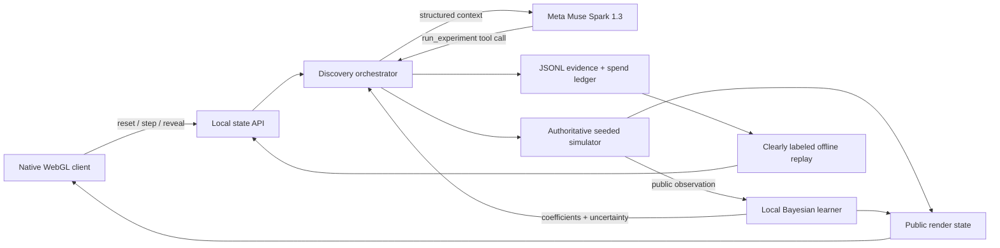

# CausalForge Architecture

## Trust boundaries

- Hidden world coefficients exist only inside the authoritative simulator until reveal.
- Muse receives public world metadata, observations, local-model estimates, and candidate uncertainty—not hidden truth.
- A scientific intervention executes only after a valid Muse `run_experiment` tool call.
- The learner trains only on observations returned by executed experiments.
- The browser contains no simulator or learning equations; it renders backend-projected state.
- Replay mode uses recorded real API evidence and is visibly labeled. It never claims to be live.

## Runtime evidence

Each experiment log includes the Muse response ID, model, tool-call count, latency, token usage, estimated cost, selected intervention, rationale, simulation observation, and learner state before and after training.
